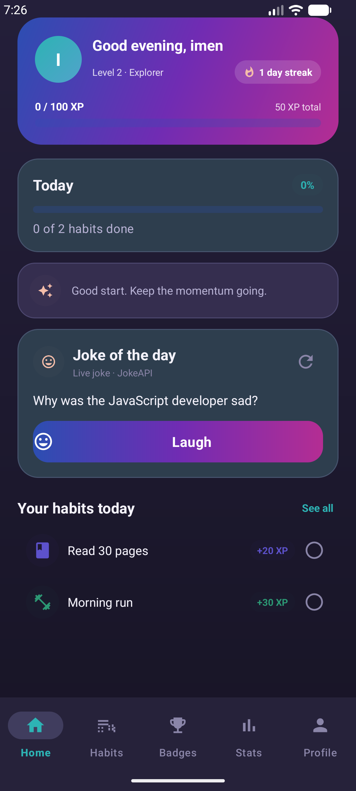
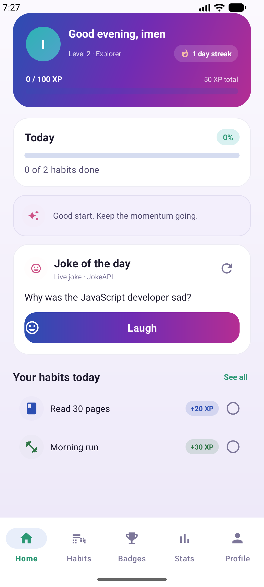
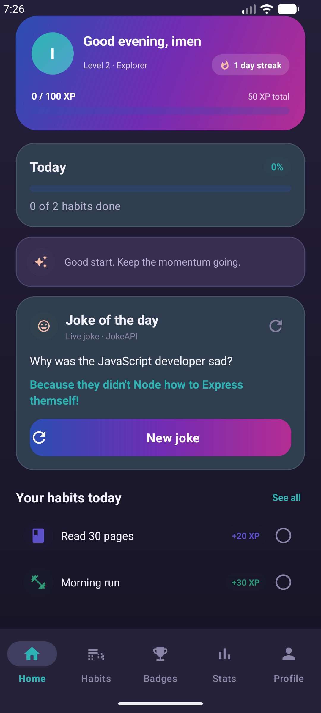
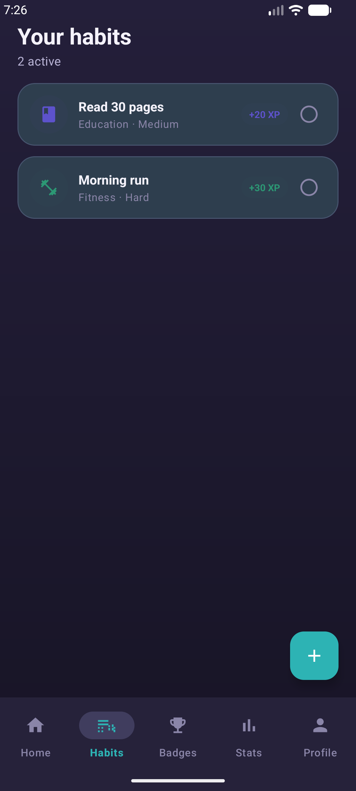
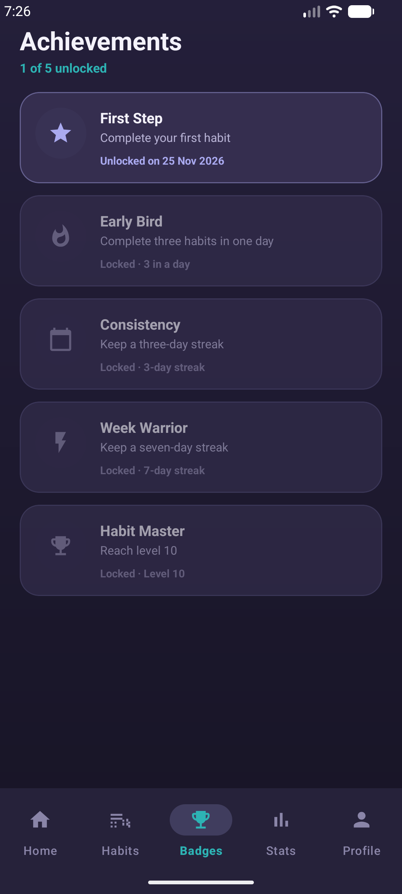
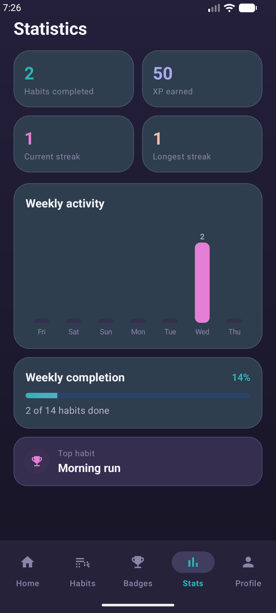
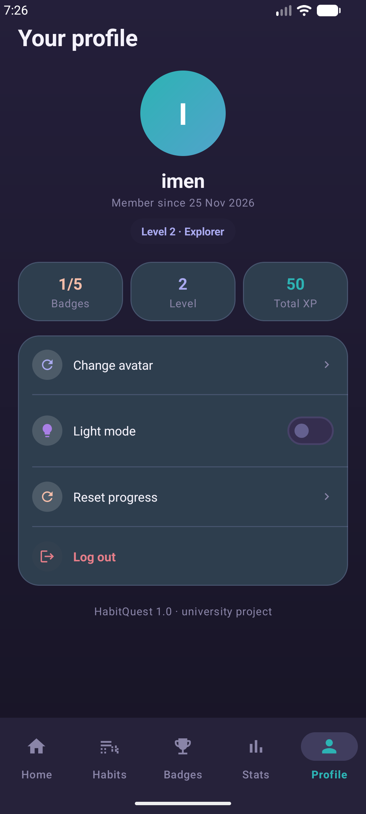

# HabitQuest

**A gamified habit tracker for Android.** Complete habits, earn XP, climb from *Beginner* to *Legend*, keep streaks alive and unlock badges — with a fresh joke on the dashboard to keep things light.

Built as a university project with **Java + XML + SQLite only**: no backend, no Kotlin, no Compose. Everything works offline; the single network call is a free, key-less joke API.

## Screenshots

<table>
  <tr>
    <td></td>
    <td></td>
    <td></td>
  </tr>
  <tr>
    <td align="center">Dashboard — dark</td>
    <td align="center">Dashboard — light</td>
    <td align="center">Joke card, punchline revealed</td>
  </tr>
  <tr>
    <td></td>
    <td></td>
    <td></td>
  </tr>
  <tr>
    <td align="center">Habits</td>
    <td align="center">Badges</td>
    <td align="center">Statistics</td>
  </tr>
</table>

 — Profile with the light/dark switch

## Features

- **Accounts** — registration and login with field validation (email format, password length), passwords stored as SHA-256 hashes, session kept across launches.
- **Dashboard** — greeting and avatar, level chip, XP progress bar, streak, daily completion, motivational line and today's habit checklist.
- **Habits** — full create / edit / delete with category and difficulty, one completion per day, XP reward animation and level-up dialog.
- **Progress** — XP by difficulty, ten levels with titles, progress persisted per user.
- **Badges** — five achievements evaluated from real activity, shown locked or unlocked with the unlock date.
- **Statistics** — habits completed, XP earned, current and longest streak, weekly completion, seven-day bar chart and top habit.
- **Profile** — avatar, level summary, badge count, dark/light switch, reset progress and logout.
- **Theming** — Material 3 DayNight with hand-tuned light and dark palettes, choice persisted in SharedPreferences.

### XP and levels

| Difficulty | XP |
| --- | --- |
| Easy | 10 |
| Medium | 20 |
| Hard | 30 |

| Level | Total XP | Title |
| --- | --- | --- |
| 1 | 0 | Beginner |
| 2 | 50 | Explorer |
| 3 | 150 | Apprentice |
| 4 | 300 | Challenger |
| 5 | 500 | Habit Hero |
| 6 | 700 | Trailblazer |
| 7 | 900 | Champion |
| 8 | 1100 | Virtuoso |
| 9 | 1300 | Grandmaster |
| 10 | 1500 | Legend |

### Badges

| Badge | Unlocked by |
| --- | --- |
| First Step | Complete your first habit |
| Early Bird | Complete three habits in one day |
| Consistency | Keep a three-day streak |
| Week Warrior | Keep a seven-day streak |
| Habit Master | Reach level 10 |

## The joke card (external API)

The dashboard consumes **[JokeAPI v2](https://v2.jokeapi.dev/)** — a free, key-less REST service:

```
GET https://v2.jokeapi.dev/joke/Any?type=twopart&safe-mode
```

- Two-part jokes only: the setup is shown and the punchline stays hidden until **Laugh** is tapped (short fade-and-slide reveal).
- **New joke** fetches another joke; a refresh icon does the same from the card header.
- The last joke is cached in SharedPreferences and reused for the rest of the day, so the app makes at most one request per day.
- All networking runs on a background executor with a main-thread callback, 8-second timeouts, and a friendly fallback when offline.

## Tech stack

| Layer | Choice |
| --- | --- |
| Language | Java 11 |
| UI | XML layouts, Material Components 1.10, AppCompat, RecyclerView, ConstraintLayout |
| Storage | SQLite via `SQLiteOpenHelper` (4 tables), SharedPreferences for session, theme and joke cache |
| Network | `HttpURLConnection` + `org.json` (no third-party HTTP library) |
| Build | Gradle 9.6.0, Android Gradle Plugin 9.4.1, minSdk 26, targetSdk 37 |
| Theming | Material 3 `DayNight.NoActionBar` with `values/` and `values-night/` palettes |

## Project structure

```
app/src/main/java/com/example/habitquest/
├── DatabaseHelper.java        # SQLite schema and queries
├── SessionManager.java        # logged-in user in SharedPreferences
├── ThemeManager.java          # dark/light preference
├── LevelSystem.java           # XP thresholds and level titles
├── ProgressManager.java       # XP, streaks and completion rules
├── JokeApi.java               # JokeAPI client with daily cache
├── MainActivity.java          # splash and routing
├── LoginActivity.java / RegisterActivity.java
├── DashboardActivity.java     # home tab
├── HabitsActivity.java / AddHabitActivity.java
├── AchievementsActivity.java  # badges tab
├── StatisticsActivity.java    # stats tab, WeeklyChartView
└── ProfileActivity.java       # profile tab
```

The database has four tables: `users`, `habits`, `habit_logs` (one row per completed habit per day) and `achievements`.

## Build and run

1. Open the project folder in Android Studio and let Gradle sync.
2. Pick a device or emulator running Android 8.0 (API 26) or newer.
3. Press **Run**.

Or build from the command line:

```bash
./gradlew assembleDebug
```

The installable build is also committed in this repository: **[apk/HabitQuest-debug.apk](apk/HabitQuest-debug.apk)** — download it on an Android phone, allow installation from unknown sources and open it. A new account can be created from the registration screen on first launch.
